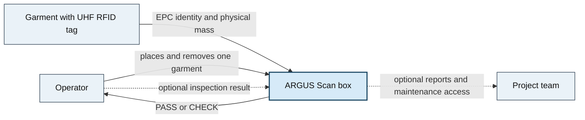
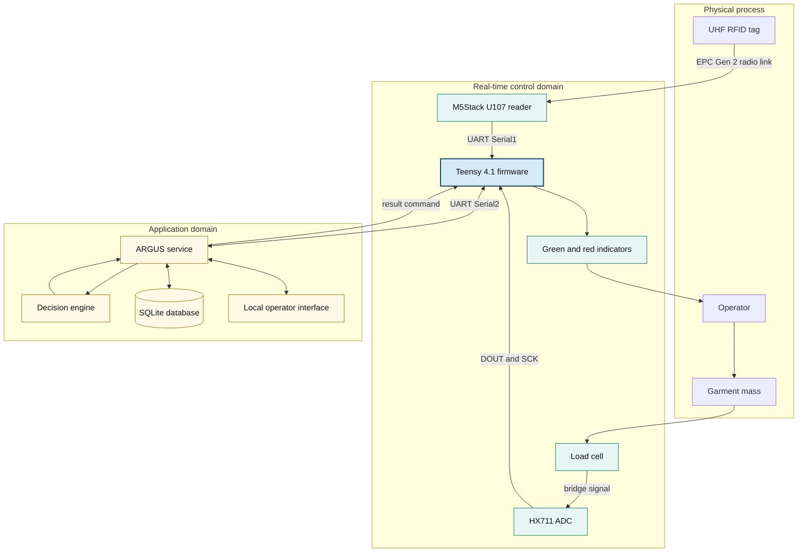
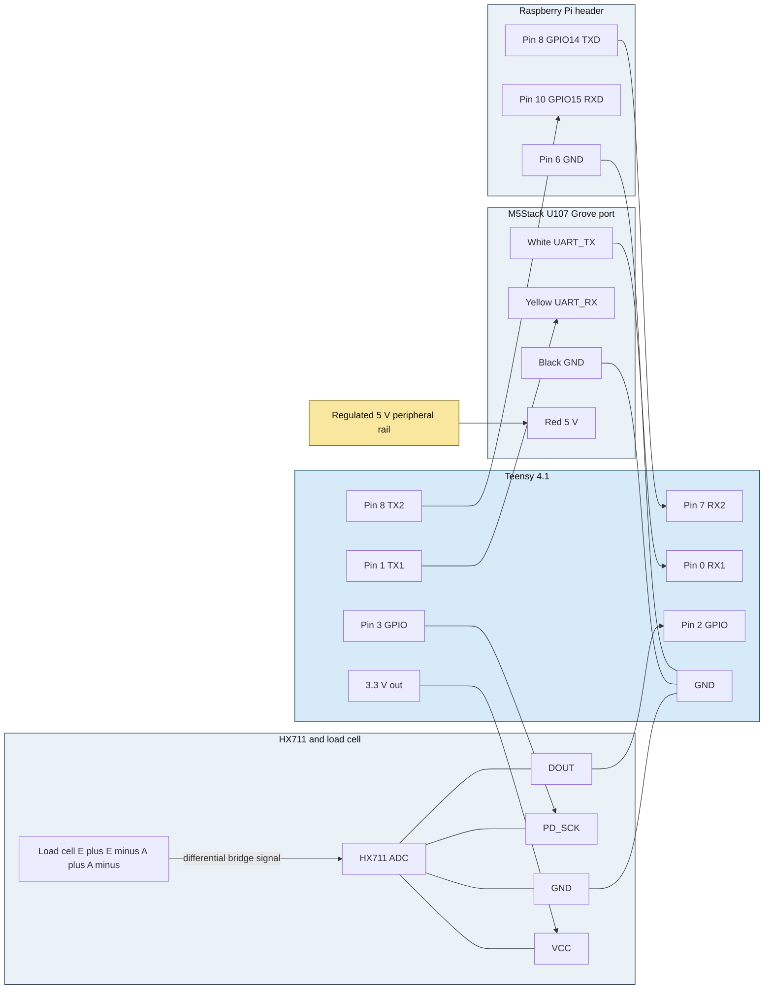
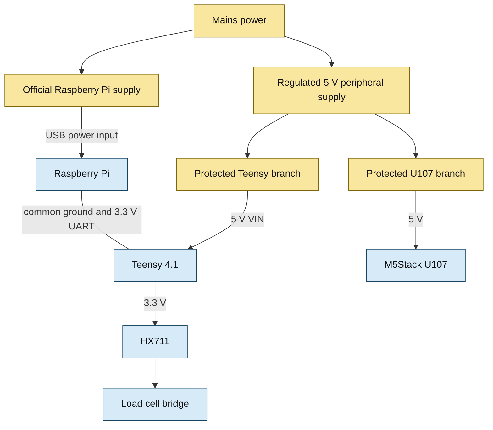
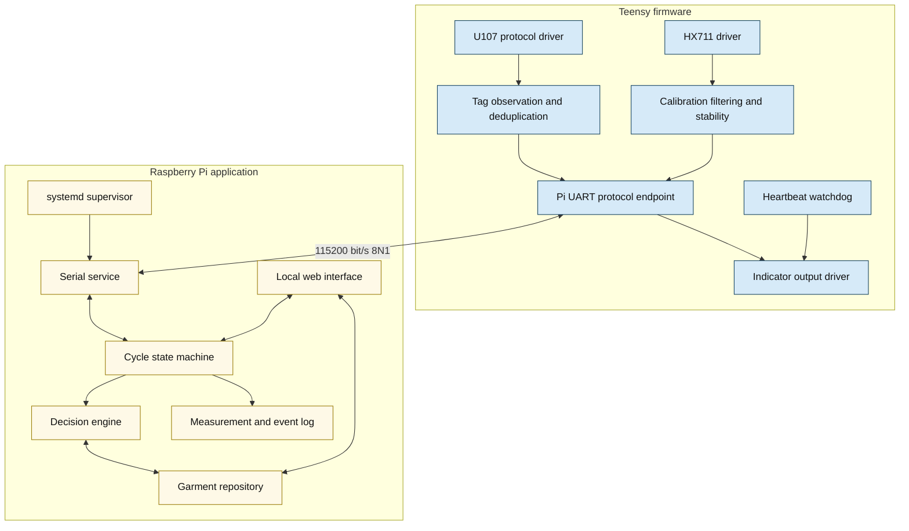
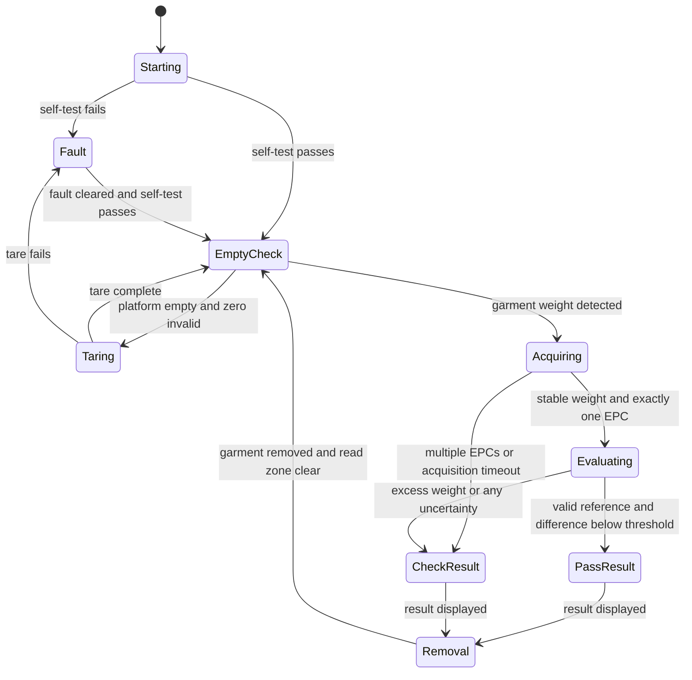
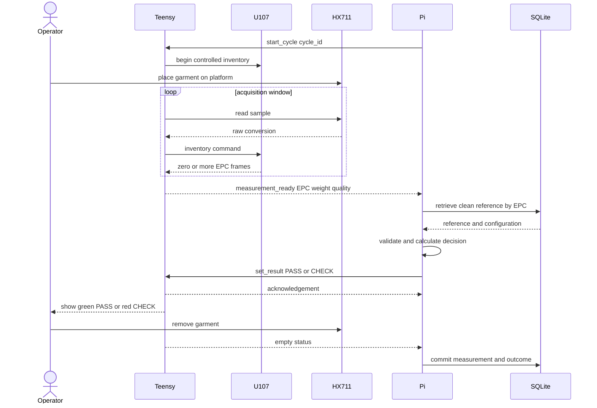
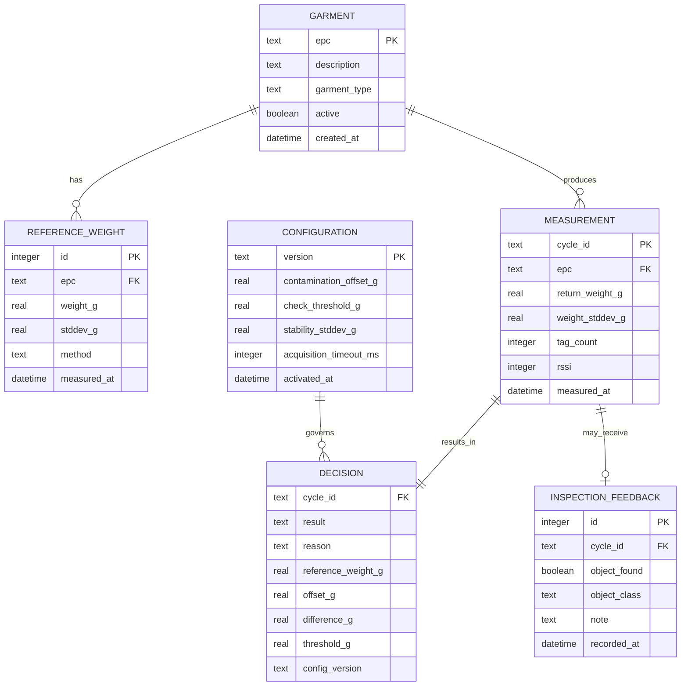

# ARGUS Scan System Architecture

- **Project:** LaundryBox prototype
- **Status:** Proposed implementation baseline
- **Date:** 15 September 2026
- **Primary components:** Raspberry Pi, Teensy 4.1, M5Stack U107 UHF RFID reader, HX711 and load cell

## 1 Purpose and scope

ARGUS Scan evaluates one garment at a time. It identifies the garment through
its UHF RFID tag, measures its returned weight, retrieves the garment's clean
reference weight, and produces one of two operator results:

- **PASS:** no manual inspection is indicated.
- **CHECK:** manual inspection is required because excess weight was detected
  or the measurement is uncertain.

This document defines the proposed hardware, power, firmware, application,
communication, data, fault-handling, calibration, and deployment architecture.
It implements the scope and safety behavior defined in
[REQUIREMENTS.md](../REQUIREMENTS.md).

The central architecture decision is to separate real-time hardware handling
from business logic:

- The **Teensy 4.1** owns the RFID reader, weighing electronics, physical
  indicators, timing-sensitive acquisition, and fail-safe behavior.
- The **Raspberry Pi** owns the measurement-cycle logic, reference-weight
  database, decision algorithm, event history, and operator interface.
- The Pi and Teensy communicate over a dedicated **3.3 V UART** connection.

## 2 System context

The system has one human actor, one measured object, and no mandatory external
service dependency. Keeping the decision path local allows the box to operate
without internet access.



**Figure 1. System context.** The garment identity and mass enter the system;
the only mandatory operational output is PASS or CHECK.

### 2.1 In scope

- One garment per measurement cycle
- UHF RFID identification without manual identifier entry
- Clean reference-weight registration and retrieval
- Returned-weight measurement from 50 g to 1000 g
- Sensitivity-first PASS or CHECK decision
- Local event logging and diagnostics
- Safe handling of missing, ambiguous, or invalid data

### 2.2 Out of scope for the first prototype

- Automatic foreign-object removal
- Bulk garment processing
- Production ERP integration
- User or wearer tracking
- Cloud availability as a prerequisite for operation
- Automatic learning of per-garment contamination offsets
- Electromagnetic metal sensing, which remains an optional extension

## 3 Logical architecture



**Figure 2. Logical component architecture.** Hardware acquisition remains
operational even if the Linux application is temporarily unavailable. A lost
Pi connection causes CHECK rather than PASS.

### 3.1 Responsibility boundary

| Capability | Teensy 4.1 | Raspberry Pi |
|---|---|---|
| RFID protocol and tag collection | Owns | Receives normalized EPC observations |
| HX711 timing and weight sampling | Owns | Receives grams and quality metadata |
| Tare and stability detection | Owns | Requests tare and validates readiness |
| Reference-weight storage | No | Owns |
| PASS or CHECK algorithm | Executes commanded result and fail-safe | Owns |
| Indicator outputs | Owns electrically | Selects requested result |
| Communication watchdog | Owns | Sends heartbeat and detects controller loss |
| Event log and operator interface | Diagnostic counters only | Owns |

## 4 Hardware architecture

### 4.1 Proposed Teensy pin allocation

The allocation leaves the U107 on the already implemented `Serial1` interface
and dedicates `Serial2` to the Raspberry Pi. The HX711 uses ordinary digital
GPIO because its interface is a clocked two-wire protocol rather than UART.

| Teensy pin | Teensy function | Connected device | Signal direction |
|---:|---|---|---|
| 0 | RX1 | U107 UART_TX, white Grove wire | U107 to Teensy |
| 1 | TX1 | U107 UART_RX, yellow Grove wire | Teensy to U107 |
| 2 | GPIO | HX711 DOUT or DT | HX711 to Teensy |
| 3 | GPIO | HX711 PD_SCK or CLK | Teensy to HX711 |
| 4 | GPIO or PWM | Green indicator driver | Teensy to driver |
| 5 | GPIO or PWM | Red indicator driver | Teensy to driver |
| 6 | GPIO with pull-up | Optional acknowledge or reset button | Button to Teensy |
| 7 | RX2 | Pi GPIO14 TXD, physical pin 8 | Pi to Teensy |
| 8 | TX2 | Pi GPIO15 RXD, physical pin 10 | Teensy to Pi |
| GND | Ground | Pi, U107, HX711, indicator drivers | Common reference |

The Teensy 4.1 offers eight hardware serial ports. PJRC assigns `Serial1` to
RX pin 0 and TX pin 1, and `Serial2` to RX pin 7 and TX pin 8 [3].

### 4.2 Electrical wiring



**Figure 3. Signal-level wiring.** TX connects to RX in both UART links. All
boards share ground. The Pi 5 V pin is not part of the communication link.

### 4.3 M5Stack U107 interface

The M5Stack U107 uses a JRD-4035 UHF reader module with a built-in antenna. The
manufacturer specifies a 115200 bit/s UART, EPCglobal UHF Class 1 Gen 2 and
ISO/IEC 18000-6C support, an 840 MHz to 960 MHz configurable frequency range,
18 dBm to 26 dBm output power, and a buffer for up to 200 tags [1].

The Grove connection is:

| Wire | U107 signal | Connection |
|---|---|---|
| Black | GND | Common system ground |
| Red | 5 V | Regulated 5 V peripheral rail |
| Yellow | UART_RX | Teensy TX1, pin 1 |
| White | UART_TX | Teensy RX1, pin 0 |

The existing firmware already opens `Serial1` at 115200 bit/s and sets the RF
transmit power to 20 dBm in
[firmware/src/main.cpp](../firmware/src/main.cpp). The local driver implements
single inventory, version query, and transmit-power commands. It does not yet
implement regulatory-region selection or multi-frame inventory collection.

Before extended RF testing, the firmware must explicitly select the legal EU
frequency plan. The U107 documentation also notes that its internal antenna is
tuned around 922 MHz, so range within the European band must be verified in the
actual enclosure [1]. The target is a controlled read zone inside the box, not
maximum possible distance. Transmit power should therefore be reduced until a
garment inside the box is read reliably while nearby garments are rejected.

The underlying JRD-4035 module specification identifies RXD and TXD as 3.3 V
TTL signals [10], which is compatible with the Teensy. Verify the assembled
U107 connector during bring-up before relying on that assumption in the final
wiring. Teensy 4.1 digital inputs are not 5 V tolerant [2].

### 4.4 HX711 and load cell interface

The load cell is the mechanical strain-gauge bridge. The HX711 is the 24-bit
analog-to-digital converter between that bridge and the Teensy. The device
supports 2.6 V to 5.5 V operation and selectable 10 or 80 samples per second
[6].

For the first prototype:

- Power a compatible HX711 breakout from the Teensy's 3.3 V output so its DOUT
  signal remains within the Teensy's input range.
- Use HX711 channel A with gain 128 unless the measured bridge output requires
  a different range.
- Start at 10 samples per second for lower noise. Evaluate 80 samples per
  second only if the 10-second system deadline cannot be met.
- Connect the cell according to its `E+`, `E-`, `A+`, and `A-` markings. Do not
  rely on wire colors without the load-cell datasheet.
- Place the HX711 close to the load cell. Keep its analog wiring short, twisted
  where practical, strain-relieved, and separated from the UHF reader and
  switched-current wiring.

If a breakout provides separate analog and digital supply pins, its own
schematic takes precedence. Confirm that DOUT never exceeds 3.3 V.

### 4.5 Raspberry Pi UART interface

The Pi and Teensy communicate through three connections:

```text
Pi GPIO14 TXD  physical pin 8  -> Teensy RX2 pin 7
Pi GPIO15 RXD  physical pin 10 <- Teensy TX2 pin 8
Pi GND         physical pin 6  --- Teensy GND
```

Both ends operate at 3.3 V. Do not attach either UART to a 5 V signal. Raspberry
Pi OS should expose the selected primary interface as `/dev/serial0`; software
should use that stable alias instead of assuming a model-specific
`/dev/ttyAMA*` or `/dev/ttyS*` device [4].

Configure Raspberry Pi OS as follows:

1. Run `sudo raspi-config`.
2. Open **Interface Options**, then **Serial Port**.
3. Disable the serial login shell.
4. Enable the serial-port hardware.
5. Reboot and verify that `/dev/serial0` exists.

The direct UART connection is appropriate for a short cable inside one
enclosure. If the cable leaves the enclosure, runs near motors or relays, or
becomes long enough to pick up interference, place 3.3 V RS-485 transceivers at
both ends and retain UART at the software boundary.

### 4.6 Indicators and controls

The system exposes exactly two operational results. The green output means
PASS; the red output means CHECK. The result should also be distinguishable by
text, icon, or physical position so color is not the only cue.

Small indicator LEDs require series resistors. Higher-current lamps, buttons
with illumination, buzzers, and stack lights require transistor or MOSFET
drivers with suitable protection. The Teensy must never source their load
current directly if it exceeds the GPIO rating.

At reset, before firmware initialization, and after loss of Pi communication,
the hardware must resolve to CHECK or to an unmistakable unavailable state
that the operator treats as CHECK. A pull resistor or driver topology should
prevent a transient green indication during boot.

## 5 Power architecture

### 5.1 Prototype power arrangement

Use two defined supplies during development:

- The Raspberry Pi uses the official supply appropriate to its model.
- A regulated 5 V peripheral supply powers the Teensy through VIN and powers
  the U107 through its 5 V input.
- The Teensy's 3.3 V regulator powers only the HX711 and other low-current
  logic within its available budget.
- The two supply domains share ground through the UART ground connection.



**Figure 4. Prototype power distribution.** Separate supply branches prevent
U107 transmit-current changes from directly disturbing the Pi supply.

PJRC connects Teensy VUSB and VIN on an unmodified board. Do not power VIN
while attaching a normal powered USB cable for programming, because current
can flow between the two sources. Either disconnect the peripheral supply
during programming, use a data cable with its 5 V conductor removed, or cut
the documented VUSB-to-VIN pads and treat the modification as part of the
hardware configuration [2].

### 5.2 Production power arrangement

A production enclosure may use one appropriately certified DC supply, but it
must have separate protected distribution branches. The Pi should receive
power through its intended power connector or a designed power-input circuit,
not through an improvised GPIO back-feed. Size the supply after measuring peak
Pi, U107, indicator, and peripheral current. Raspberry Pi documents model-
specific supply requirements and limited downstream USB current [5].

Include:

- input fuse and switch;
- reverse-polarity and transient protection where applicable;
- separate branch protection for computing and peripheral loads;
- bulk capacitance near the U107, validated by oscilloscope during inventory;
- strain relief and keyed connectors;
- a clean shutdown strategy or read-only/resilient filesystem configuration
  if operators can remove power without shutting Linux down.

## 6 Mechanical and electromagnetic design

The weighing platform and RF read zone interact physically even though their
electronics are separate.

### 6.1 Scale mechanics

- Mount the load cell according to its fixed-end and live-end specification.
- Ensure the platform contacts only the sensing structure and cannot bottom
  out against the enclosure within the 1000 g operating range plus overload
  margin.
- Route cables with flexible service loops so they do not exert a repeatable
  force on the platform.
- Keep the Raspberry Pi, power supplies, fan, controls, and enclosure panels
  off the measured structure.
- Provide overload stops if operators could lean on or drop objects onto the
  platform.
- Use a smooth, wipe-clean garment-contact surface without snag points.

### 6.2 RFID read zone

UHF performance depends on tag orientation, antenna polarization, surrounding
metal, water content, and nearby tags. The enclosure design must therefore be
tested with real garments rather than optimized on the supplied sample tag.

- Place the U107 so the main read field intersects likely tag locations.
- Keep metal panels and the load-cell body from detuning or shadowing the
  antenna where possible.
- Use physical separation, absorptive material, conductive shielding, and RF
  power adjustment as experimental variables.
- Define a staging area that keeps waiting garments outside the read zone.
- Treat multiple EPCs during one acquisition window as ambiguity and return
  CHECK.
- Test dry, damp, folded, crumpled, and differently oriented garments.

## 7 Software architecture



**Figure 5. Software components.** The Teensy reports sensor facts and quality
metadata. The Pi combines them with stored reference data and decides the
operator result.

### 7.1 Teensy firmware

The firmware should use a non-blocking main loop or cooperative scheduler.
RFID parsing, HX711 sampling, Pi message parsing, outputs, and the heartbeat
watchdog must continue independently. A timeout in one device driver must not
starve the other tasks.

Required firmware modules are:

1. **U107 driver:** framed command transmission, checksum validation, complete
   multi-frame response parsing, region configuration, output-power control,
   version query, and error reporting.
2. **Tag tracker:** observation window, EPC deduplication, RSSI tracking, tag
   count, and multiple-tag detection.
3. **HX711 driver:** startup, power control, sample acquisition, raw-value
   timeout, and gain or rate selection.
4. **Weight processor:** tare offset, scale factor, grams conversion, median or
   outlier filter, rolling mean, noise estimate, drift estimate, and stability
   result.
5. **Pi protocol endpoint:** framed messages, CRC validation, sequence numbers,
   acknowledgements, retries, and diagnostic counters.
6. **Output manager:** deterministic PASS, CHECK, startup, and communication-
   lost behavior.
7. **Watchdog:** hardware watchdog plus Pi-heartbeat timeout.

The firmware should report its semantic version, board reset cause, calibration
identifier, U107 version, and fault flags in its startup message.

### 7.2 Raspberry Pi application

The application can begin as a single Python service with internal modules.
Splitting it into networked microservices would add deployment and failure
modes without improving this single-station prototype.

The service owns:

- serial connection and recovery;
- the end-to-end cycle state machine;
- clean reference registration;
- reference lookup and validation;
- contamination-offset configuration;
- threshold configuration and decision calculation;
- measurement, decision, and fault logs;
- local operator and maintenance views;
- optional manual-inspection feedback;
- health endpoint and structured application logs.

Run the service under `systemd` with automatic restart, bounded restart delay,
and logs in the system journal. Database writes should be transactional.

## 8 Pi to Teensy communication protocol

### 8.1 Physical and link settings

| Property | Value |
|---|---|
| Electrical interface | 3.3 V TTL UART |
| Teensy port | `Serial2`, RX pin 7 and TX pin 8 |
| Pi port | `/dev/serial0` on GPIO14 and GPIO15 |
| Initial rate | 115200 bit/s |
| Character format | 8 data bits, no parity, 1 stop bit |
| Flow control | None initially |
| Application framing | One UTF-8 JSON object per line |
| Integrity | CRC-16 field over canonical message content |
| Reliability | Sequence number, acknowledgement, timeout, retry |

Newline-delimited JSON is easy to inspect during development. The protocol is
low-volume, so human-readable framing is more valuable than a compact binary
format. A maximum line length should be enforced on both sides so malformed
input cannot exhaust a buffer.

### 8.2 Common envelope

```json
{
  "v": 1,
  "seq": 126,
  "type": "measurement_ready",
  "body": {},
  "crc16": "A92F"
}
```

The CRC calculation must be specified in the implementation protocol before
interoperability testing. That specification must define the polynomial,
initial value, byte encoding, field order, whitespace handling, and which
fields are covered. A practical approach is to compute the CRC over the UTF-8
encoding of `v`, `seq`, `type`, and a canonically serialized `body`, excluding
the `crc16` field.

### 8.3 Required messages

| Direction | Type | Purpose |
|---|---|---|
| Teensy to Pi | `hello` | Firmware, reset cause, calibration and device versions |
| Both | `heartbeat` | Connection supervision and liveness |
| Pi to Teensy | `start_cycle` | Clear prior observations and start acquisition |
| Pi to Teensy | `tare` | Request empty-platform zeroing |
| Teensy to Pi | `tare_result` | Tare success, raw offset, noise and fault details |
| Teensy to Pi | `status` | Current weight, stability, tag count and faults |
| Teensy to Pi | `measurement_ready` | Stable weight and RFID evidence for a cycle |
| Pi to Teensy | `set_result` | Display PASS or CHECK for a specific cycle |
| Pi to Teensy | `reset_cycle` | Return to empty-box monitoring |
| Both | `ack` | Confirm an important message sequence number |
| Both | `error` | Report protocol, sensor, state, or command failure |

Example measurement:

```json
{
  "v": 1,
  "seq": 126,
  "type": "measurement_ready",
  "body": {
    "cycle_id": "20260915T142233Z-0042",
    "epc": "E28011052000742A19B60C31",
    "weight_g": 437.6,
    "weight_stddev_g": 0.7,
    "stable_ms": 1000,
    "tag_count": 1,
    "rssi": 74,
    "faults": []
  },
  "crc16": "A92F"
}
```

Example result command:

```json
{
  "v": 1,
  "seq": 127,
  "type": "set_result",
  "body": {
    "cycle_id": "20260915T142233Z-0042",
    "result": "CHECK",
    "reason": "excess_weight"
  },
  "crc16": "0D31"
}
```

### 8.4 Communication safety rules

- A command applies only to its matching `cycle_id`.
- Duplicated commands are idempotent and receive the same acknowledgement.
- An invalid CRC, oversized line, unknown version, or impossible field value is
  rejected and counted.
- The Teensy enters communication-lost behavior if valid Pi heartbeats stop for
  a configured interval.
- The Pi enters controller-offline behavior if heartbeats or status messages
  stop.
- Reconnection begins with `hello` and a state reconciliation. Neither side
  assumes that the other retained an incomplete cycle.

## 9 Measurement-cycle behavior



**Figure 6. Measurement state machine.** Every uncertain branch leads to CHECK
or Fault. Only a complete and valid evidence chain reaches PASS.

### 9.1 End-to-end sequence



**Figure 7. Nominal measurement sequence.** RFID and weight acquisition overlap
to meet the response-time requirement.

### 9.2 Acquisition rules

A measurement is ready only when all of the following are true:

- measured mass is within the configured garment range;
- scale samples satisfy the stability thresholds for a minimum duration;
- exactly one distinct EPC is present during the observation window;
- the EPC has been observed enough times to reject isolated frames;
- neither sensor reports a fault;
- the Pi connection is active;
- the total acquisition deadline has not expired.

The initial stability algorithm should combine a rolling standard deviation
limit with a maximum slope or drift limit. Both thresholds must be derived from
measured prototype noise, not chosen from the HX711's nominal 24-bit resolution.

## 10 Data architecture

SQLite is sufficient for one prototype station. It provides transactions,
local persistence, straightforward backup, and no separate database service.



**Figure 8. Initial data model.** References remain historical rather than
being overwritten silently, and each decision records the exact configuration
that produced it.

### 10.1 Data integrity

- Normalize EPC values as uppercase hexadecimal without separators.
- Store weight internally in a single documented unit, preferably grams as a
  floating-point measurement and raw HX711 counts alongside diagnostics when
  useful.
- Give every cycle a unique identifier generated by the Pi.
- Record the selected reference weight, offset, threshold, software version,
  firmware version, and result reason with each decision.
- Commit the measurement and decision in one transaction.
- Back up the SQLite file through a controlled mechanism that does not copy an
  inconsistent live database.

## 11 Decision architecture

The first decision method compares the returned garment against its clean
reference:

```text
normalized difference = returned weight - clean reference - configured offset
```

The configurable offset represents an explicitly documented allowance, such
as expected contamination. It remains zero until experimental evidence
supports a different value.

PASS is permitted only when:

```text
identity valid
AND exactly one tag observed
AND clean reference exists and is valid
AND weight measurement is stable and in range
AND no sensor or communication fault exists
AND normalized difference is below the validated CHECK threshold
```

Every other outcome produces CHECK. A negative difference outside a validated
tolerance also produces CHECK because it may indicate a wrong garment,
incorrect reference, calibration error, or incomplete placement.

Threshold selection must use labeled test data and prioritize the required
false-negative target. HX711 bit depth, load-cell resolution, and individual
object weights do not by themselves establish the correct system threshold.

### 11.1 Decision reasons

Use machine-readable reason values so results can be analyzed later:

| Result | Reason | Meaning |
|---|---|---|
| PASS | `within_threshold` | Complete evidence and difference below threshold |
| CHECK | `excess_weight` | Difference meets or exceeds threshold |
| CHECK | `missing_reference` | EPC has no active clean reference |
| CHECK | `multiple_tags` | More than one distinct EPC was observed |
| CHECK | `missing_tag` | Stable garment weight but no valid EPC |
| CHECK | `unstable_weight` | Stability criteria were not met before timeout |
| CHECK | `weight_out_of_range` | Measurement lies outside configured range |
| CHECK | `negative_difference` | Return weight is implausibly below reference |
| CHECK | `sensor_fault` | RFID, HX711, or calibration fault |
| CHECK | `communication_fault` | Pi and Teensy state cannot be trusted |
| CHECK | `internal_error` | Application or database processing failed |

## 12 Fault handling

| Failure | Detection | Required behavior | Recovery |
|---|---|---|---|
| U107 absent or invalid response | Version query or command timeout | CHECK and RFID fault | Retry bounded times, then maintenance action |
| Multiple UHF tags | More than one EPC in window | CHECK | Remove other garment and restart cycle |
| No RFID tag | Stable weight without EPC until timeout | CHECK | Reposition garment or inspect tag |
| HX711 unavailable | DOUT timeout or impossible samples | CHECK and scale fault | Reinitialize; require empty-scale verification |
| Scale overload | Counts or mass beyond configured limit | CHECK and overload fault | Remove load; inspect mechanics and recalibrate if needed |
| Unstable platform | Noise or slope limit exceeded | CHECK after deadline | Remove vibration and restart |
| Pi UART lost | Teensy heartbeat timeout | Red CHECK or unavailable indication | Reconnect, exchange hello, discard incomplete cycle |
| Teensy offline | Pi heartbeat or status timeout | UI shows controller offline; no PASS | Restart service or controller and self-test |
| Reference missing | Database lookup returns no valid row | CHECK | Register a clean reference through maintenance workflow |
| Database write fails | Transaction error | CHECK and preserve diagnostic log | Restore storage or database, then retry new cycle |
| Unexpected power loss | Boot reset cause and incomplete cycle | No automatic PASS | Self-test, empty check, and new cycle |

The hardware watchdog should restart the Teensy if its main loop stalls. After
any reset, outputs return to fail-safe state and the Pi treats the previous
cycle as incomplete.

## 13 Calibration and validation

### 13.1 Scale calibration

1. Warm the electronics for a defined period.
2. Verify that the platform is empty and mechanically free.
3. Record the raw zero offset from multiple samples.
4. Apply at least one traceable calibration mass; preferably use several
   points spanning 50 g to 1000 g.
5. Fit the scale factor and check linearity, repeatability, hysteresis, and
   corner loading.
6. Store the calibration identifier, timestamp, factors, test masses, and
   residual errors.
7. Repeat after mechanical changes, load-cell replacement, overload, or
   unexplained drift.

The prototype must demonstrate that its system-level uncertainty is small
enough to distinguish the lightest target object. Nominal ADC resolution is
not evidence of achieved weighing accuracy.

### 13.2 RFID validation

Build a test matrix covering:

- all garment tag models and placements;
- dry and damp garments;
- folded, crumpled, and rotated presentations;
- empty box, one garment, and multiple garments;
- nearby garments outside the intended read zone;
- RF power and legal EU channel configuration;
- antenna location and enclosure variants;
- repeated reads across the complete 10-second deadline.

Measure identification success, time to first valid EPC, false nearby-tag
reads, multi-tag detection, and the effect of garment moisture.

### 13.3 Decision validation

Collect labeled measurements for clean and returned garments with and without
the target object classes. Separate threshold-development data from final
evaluation data. Report at least false-negative rate, false-positive rate,
decision latency, missing-tag rate, unstable-measurement rate, and confidence
intervals or sample counts.

## 14 Deployment and operation

### 14.1 Raspberry Pi deployment

- Use Raspberry Pi OS with only required packages installed.
- Run the application as a dedicated unprivileged user.
- Grant that user access to `/dev/serial0` without running the application as
  root.
- Start the service with `systemd` after the serial device and local storage
  are available.
- Store configuration outside the application binary and version every active
  decision configuration.
- Rotate logs and monitor free storage.
- Use atomic software updates with a documented rollback procedure.
- Restrict the maintenance interface to the local network or device.

### 14.2 Startup sequence

1. Teensy outputs default to CHECK or unavailable.
2. Teensy initializes GPIO, watchdog, HX711, U107, and Pi UART.
3. Teensy verifies sensor communication and reports `hello`.
4. Pi application opens `/dev/serial0` and validates the protocol version.
5. Pi and Teensy exchange configuration and health state.
6. System verifies that the platform and read zone are empty.
7. System tares if required.
8. Only then does the operator interface show ready for a new garment.

### 14.3 Shutdown and recovery

The operator should use a controlled shutdown action where practical. If power
can be removed without warning, use a filesystem and storage design intended
for that environment. On the next boot, discard any cycle without a committed
measurement and decision, run the complete self-test, and require an empty box
before returning to service.

## 15 Implementation plan

### Phase 1 Hardware bring-up

- Confirm U107 version query and single-tag inventory on Teensy `Serial1`.
- Measure U107 UART levels and current behavior.
- Wire the HX711 and calibrate raw counts to grams.
- Confirm Teensy `Serial2` communication with `/dev/serial0` on the selected Pi.
- Verify all grounds and power rails under U107 inventory load.

### Phase 2 Teensy acquisition firmware

- Replace blocking RFID parsing with complete frame handling.
- Add region selection, controlled inventory windows, and multiple-tag logic.
- Add HX711 filtering, tare, stability, range, and timeout behavior.
- Add Pi protocol, CRC, acknowledgement, heartbeat, watchdog, and outputs.

### Phase 3 Pi application

- Implement serial service and cycle state machine.
- Create database schema and reference-registration workflow.
- Implement fail-safe decision engine and reason codes.
- Add local operator view and diagnostics.
- Package the application as a `systemd` service.

### Phase 4 System validation

- Validate scale accuracy and stability across the required range.
- Characterize the UHF read zone with real garments.
- Collect labeled object-detection data.
- Select thresholds against the false-negative requirement.
- Test every fault path and recovery procedure.

## 16 Requirements traceability

| Requirement | Architectural response |
|---|---|
| M-01 one garment per cycle | Pi state machine plus Teensy multiple-EPC detection |
| M-02 placement and removal only | Automatic weight and RFID acquisition |
| M-03 RFID identity | U107 on Teensy `Serial1` |
| M-04 clean reference retrieval | Pi SQLite garment and reference tables |
| M-05 50 g to 1000 g | Load-cell sizing and multi-point calibration plan |
| M-06 result within 10 seconds | Concurrent RFID and weight acquisition with deadline |
| M-07 exactly PASS or CHECK | Two result commands and physical outputs |
| M-08 pens through heavier tools | Labeled validation dataset includes target classes |
| M-09 false negatives at most 10 percent | Sensitivity-first threshold validation |
| M-10 sensitivity priority | All uncertainty maps to CHECK |
| M-11 safe garment surfaces | Smooth wipe-clean platform and controlled cable routing |
| M-12 resolve lightest target mass | System-level uncertainty and object testing |
| M-13 uncertainty produces CHECK | Explicit fault table and decision predicate |

## 17 Open engineering decisions

The following decisions require measured prototype data or the exact purchased
parts:

1. Raspberry Pi model and its final power budget
2. Load-cell capacity, geometry, overload rating, and cable color mapping
3. HX711 breakout schematic and analog or digital supply arrangement
4. Confirmation that the assembled U107 exposes the documented 3.3 V UART
5. U107 EU configuration command and achievable read-zone containment
6. Weight stability window, standard-deviation limit, and drift limit
7. Contamination offset and CHECK threshold
8. Pi to Teensy CRC-16 definition and timeout values
9. Indicator electrical ratings and driver circuit
10. Enclosure material, antenna placement, shielding, and service access

## 18 References

1. M5Stack, [Unit UHF RFID U107 product documentation](https://docs.m5stack.com/en/unit/uhf_rfid).
2. PJRC, [Teensy 4.1 hardware and electrical limits](https://www.pjrc.com/store/teensy41.html).
3. PJRC, [Teensy hardware serial port assignments](https://www.pjrc.com/teensy/td_uart.html).
4. Raspberry Pi, [UART configuration](https://www.raspberrypi.com/documentation/computers/configuration.html#configure-uarts).
5. Raspberry Pi, [Power supply and USB current guidance](https://www.raspberrypi.com/documentation/computers/raspberry-pi.html#power-supply).
6. Avia Semiconductor, [HX711 datasheet](https://e2e.ti.com/cfs-file/__key/communityserver-discussions-components-files/73/HX711.pdf).
7. Project baseline, [README.md](../README.md).
8. Project requirements, [REQUIREMENTS.md](../REQUIREMENTS.md).
9. Local U107 protocol supplement, [M100 QM100 Firmware Command Manual English Supplement](rfid/u107/M100_QM100_Protocol_v2.3.4_Supplement_EN.md).
10. Local module specification, [JRD 4035 Module Specification](rfid/u107/JRD-4035_Module_Specification_EN.md).
