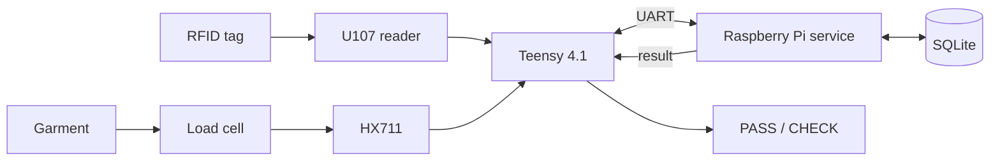

# ARGUS Scan System Architecture

- **Project:** LaundryBox prototype
- **Status:** Proposed implementation baseline
- **Main components:** Raspberry Pi, Teensy 4.1, M5Stack U107 UHF RFID
  reader, HX711, and load cell

## 1. Purpose

ARGUS Scan evaluates one garment at a time. It identifies the garment by UHF
RFID, measures its returned weight, compares it with a clean reference, and
outputs:

- **PASS:** the measurement is valid and within the allowed difference.
- **CHECK:** excess weight or any uncertainty requires manual inspection.

The detailed functional and safety requirements remain in
[REQUIREMENTS.md](../REQUIREMENTS.md).

## 2. System design



The Teensy handles timing-sensitive hardware and fail-safe outputs. The
Raspberry Pi owns the final cycle logic, reference database, history, and user
interface.

| Capability | Teensy | Raspberry Pi |
|---|---|---|
| RFID and HX711 communication | Owns | Receives observations |
| Tare, filtering, and stability | Owns | Checks readiness |
| Reference weights and history | — | Owns |
| Final PASS/CHECK decision | Displays and fails safe | Owns |
| Health supervision | Hardware and UART watchdogs | Service monitoring |

### Current minimal prototype

The current bring-up firmware is intentionally simpler:

- weight sensing only, without the Pi or RFID decision path;
- calibration with **1 Argus = 557.4 g**;
- clean target weight hard-coded on the Teensy;
- **PASS** when the absolute difference is at most 3.0 g, otherwise **CHECK**;
- results printed to the USB serial monitor.

This verifies the mechanical scale and detection idea before system
integration. It is not the final firmware architecture.

## 3. Hardware

### Teensy pin allocation

| Pin | Function | Connection |
|---:|---|---|
| 0 | RX1 | U107 TX |
| 1 | TX1 | U107 RX |
| 2 | GPIO | HX711 DOUT |
| 3 | GPIO | HX711 PD_SCK |
| 4 | GPIO/PWM | Green PASS indicator |
| 5 | GPIO/PWM | Red CHECK indicator |
| 6 | GPIO | Optional button |
| 7 | RX2 | Pi GPIO14 TXD |
| 8 | TX2 | Pi GPIO15 RXD |
| GND | Ground | Common ground |

### Electrical rules

- Use 3.3 V logic between the Pi and Teensy.
- Power a compatible HX711 breakout from 3.3 V and verify that DOUT never
  exceeds 3.3 V; Teensy 4.1 inputs are not 5 V tolerant.
- Power the U107 from a regulated 5 V rail and connect its UART to
  `Serial1` at 115200 bit/s.
- Share ground between the Pi, Teensy, U107, and HX711.
- Drive high-current indicators through suitable transistor or MOSFET
  circuits. GPIO pins must not supply their load current directly.
- Do not power an unmodified Teensy simultaneously through VIN and ordinary
  USB 5 V. Disconnect one source or apply the documented VUSB/VIN separation.

During development, use the Pi's appropriate official supply and a separate,
regulated peripheral supply for the Teensy and U107. Verify power rails while
the RFID reader is transmitting.

### Scale mechanics

The single bending-beam load cell is installed between two offset supports:

- the bottom spacer attaches the fixed end to the base plate;
- the top spacer attaches the opposite, live end to the top plate;
- the slotted sensing section remains unsupported and free to flex;
- the box stays on the top plate and is removed from measurements by tare.

The top and base plates must never touch under load. Route the load-cell cable
so it cannot pull on the live end. Keep the total dead load plus garment and
test mass below the load cell's rated capacity. Wooden spacers are acceptable
for bring-up; rigid spacers are preferable if compression or humidity causes
drift.

### RFID

The U107 uses EPC Gen 2 / ISO 18000-6C and a serial interface. Before system
testing:

- configure a legal European frequency plan;
- reduce transmit power until garments inside the box are reliable while
  nearby garments are rejected;
- test realistic tag locations, garment orientations, and moisture levels;
- treat zero or multiple tags as CHECK.

## 4. Software

### Teensy firmware

The integrated firmware should use a non-blocking loop so one slow peripheral
cannot stop the others. Its main responsibilities are:

- parse complete U107 frames and collect unique EPC observations;
- read the HX711 with timeouts;
- apply tare and calibration, filter samples, and determine stability;
- exchange framed messages with the Pi;
- control indicators and enter CHECK/unavailable on communication loss;
- run a hardware watchdog.

### Raspberry Pi application

A single Python service is sufficient for the prototype. It owns:

- the measurement-cycle state machine;
- garment reference registration and lookup;
- the PASS/CHECK decision;
- measurement and fault logging;
- a local operator/maintenance interface.

Run it under `systemd` as an unprivileged user. Use transactional SQLite
writes and structured logs.

### Pi–Teensy protocol

Use a 3.3 V UART connection:

```text
Pi GPIO14 TXD (pin 8)  -> Teensy RX2 (pin 7)
Pi GPIO15 RXD (pin 10) <- Teensy TX2 (pin 8)
Pi GND                 --- Teensy GND
```

Initial settings are 115200 bit/s, 8N1, with one JSON object per line. Messages
include a protocol version, sequence number, type, body, and cycle identifier.
Enforce a maximum line length. Add acknowledgements and a fully specified CRC
if testing shows that they are needed.

Required message types:

| Direction | Type | Purpose |
|---|---|---|
| Teensy → Pi | `hello`, `heartbeat`, `status` | Version and health |
| Pi → Teensy | `start_cycle`, `tare`, `reset_cycle` | Cycle control |
| Teensy → Pi | `measurement_ready` | EPC, weight, stability, and faults |
| Pi → Teensy | `set_result` | PASS or CHECK for one cycle |
| Both | `ack`, `error` | Reliability and diagnostics |

Commands apply only to their matching cycle. After reconnection, discard any
incomplete cycle and reconcile state before allowing PASS.

## 5. Operation

### Minimal weight-only calibration

The plate and empty box remain installed:

1. Warm the electronics and leave the box empty.
2. Tare the empty plate-and-box assembly.
3. Place the 557.4 g Argus mass centrally in the box.
4. Measure stable raw counts and calculate counts per gram.
5. Remove Argus and tare the empty assembly again.
6. Add the test item and report its net weight.

The current firmware recalibrates after every restart. A later version should
store the validated scale factor and normally perform only an empty-box tare
at startup.

### Integrated measurement cycle

1. Start in CHECK/unavailable and run self-tests.
2. Confirm that the box is empty and tare if needed.
3. Detect an added garment and collect weight and RFID observations together.
4. Continue until the weight is stable and exactly one EPC is valid, or until
   the acquisition deadline expires.
5. Retrieve the clean reference and evaluate the result.
6. Display PASS or CHECK and log the complete decision.
7. Wait for garment removal before starting the next cycle.

PASS is allowed only when identity, reference, weight stability, sensor health,
and communication are all valid. Every uncertain case produces CHECK.

For the minimal prototype:

```text
difference = abs(measured weight - hard-coded clean weight)
PASS  if difference <= threshold
CHECK otherwise
```

## 6. Data

SQLite stores:

- garments and EPC identifiers;
- historical clean reference measurements;
- returned measurements and quality data;
- decisions, reasons, and active thresholds;
- optional inspection feedback.

Each cycle has a unique identifier. Store weights in grams and retain raw
counts for diagnostics. Commit the measurement and decision together, and
record the software, firmware, calibration, and configuration versions used.

## 7. Fault behavior

| Condition | Result |
|---|---|
| Missing or multiple RFID tags | CHECK |
| Missing clean reference | CHECK |
| Unstable, implausible, or overloaded scale | CHECK |
| HX711 or U107 timeout | CHECK and sensor fault |
| Lost Pi/Teensy communication | CHECK or unavailable |
| Internal or database error | CHECK |
| Unexpected reset or power loss | Discard incomplete cycle and self-test |

The system must never show a transient PASS during boot. Hardware and software
watchdogs return outputs to CHECK/unavailable when state cannot be trusted.

## 8. Calibration and validation

### Scale

- Warm up before calibration.
- Tare the permanently installed empty plate and box.
- Use several externally verified masses spanning the intended range.
- Repeat placement at the center and corners.
- Measure linearity, repeatability, hysteresis, noise, and drift.
- Recalibrate after mechanical changes, overload, unexplained drift, or load
  cell replacement.

A ±3 g decision threshold is usable only if measured system uncertainty and
placement variation are comfortably smaller than 3 g.

### RFID and decision

Test dry and damp garments, different folds and tag positions, nearby tags,
multiple tags, and the full enclosure. Record identification success, nearby
tag reads, missing-tag rate, measurement stability, decision latency, false
positives, and false negatives. Select final thresholds from labeled test
data, prioritizing the false-negative requirement.

## 9. Next steps and open decisions

1. Validate the scale at 0 g, 557.4 g, and additional known masses.
2. Measure whether wooden spacers or load position cause unacceptable error.
3. Integrate non-blocking HX711 and U107 acquisition on the Teensy.
4. Confirm U107 EU configuration and contain the RFID read zone.
5. Implement the Pi UART protocol, SQLite model, and decision service.
6. Add indicators, heartbeat handling, and watchdog behavior.
7. Determine final load-cell capacity, stability limits, and CHECK threshold
   from prototype measurements.

## References

1. [M5Stack U107 documentation](https://docs.m5stack.com/en/unit/uhf_rfid)
2. [PJRC Teensy 4.1 hardware information](https://www.pjrc.com/store/teensy41.html)
3. [PJRC serial-port assignments](https://www.pjrc.com/teensy/td_uart.html)
4. [Raspberry Pi UART configuration](https://www.raspberrypi.com/documentation/computers/configuration.html#configure-uarts)
5. [HX711 datasheet](https://e2e.ti.com/cfs-file/__key/communityserver-discussions-components-files/73/HX711.pdf)
6. [Local U107 protocol supplement](rfid/u107/M100_QM100_Protocol_v2.3.4_Supplement_EN.md)
7. [Local JRD-4035 module specification](rfid/u107/JRD-4035_Module_Specification_EN.md)
